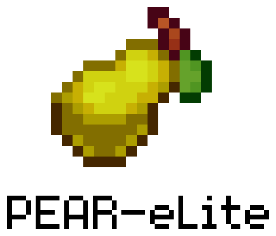

<p align="center">
  <picture>
    <source media="(prefers-color-scheme: dark)" srcset="docs/assets/pear_elite_logo_dark.svg">
    
  </picture>
</p>

<p align="center">
PEAR-27B 的思维链退火、小模型蒸馏与 slime 适配
</p>

---

PEAR-eLite 把 [PEAR](https://github.com/mit-han-lab/pear) 的 27B 机器人推理模型 Qwen3.8-27B-PEAR-LIBERO_only（下称 PEAR-27B）轻量化到多数实验室能训练和评测的规模。仓库提供四类配方：

| 配方 | 内容 | 后端 | 硬件 | 状态 |
|---|---|---|---|---|
| [SFT](recipes/sft/README.md) | PEAR-27B 成功轨迹 → Qwen3.5-4B/9B 学生全参数 SFT | verl、slime | 8 × RTX 5090 / 8 × H100 | 已完成 |
| [OPD](recipes/opd/README.md) | 回放式在线蒸馏（ReOPD）：学生在 27B 轨迹的前缀上生成，教师逐 token 打分，思考档位 xhigh → medium → low | slime | 8 × H100 | 运行中 |
| [思维链退火](recipes/anneal/README.md) | PEAR-27B 三阶段自训练：每档位取每个任务最短的成功轨迹做 LoRA SFT，xhigh → medium → low | verl | 8 × RTX 5090 | A1 已完成，A2、A3 运行中 |
| [slime 适配](recipes/slime/README.md) | 版本固定的 slime / SGLang / Megatron 环境，PEAR 多轮多模态轨迹的训练与蒸馏接口 | slime | H100 | 已完成 |

另为游戏强化学习环境预留了位置（[`pear/envs/games/`](pear/envs/games/README.md)），接口与 LIBERO 相同。

## 结果

LIBERO，40 局（trial 0），xhigh，BF16，温度 0。

| 模型 | 训练数据 | 成功 | 状态 |
|---|---|---:|---|
| Qwen3.5-4B / 9B（未训练） | — | 0/40 | 已确认 |
| 4B 学生，verl | 388 条 | 15/40 | 已确认 |
| 9B 学生，verl | 388 条 | 22/40 | 已确认 |
| 9B 学生，slime | 388 条 | 26/40 | 已确认 |
| 4B 学生 v2，verl | 1250 条 | — | 结论待定 |

PEAR-27B 思维链缩短（单阶段 RFT，medium，79 局配对）：每轮生成 token 1020 → 803（−21%），成功率 25.3% → 30.4%，p = 0.541，差异不显著。三阶段退火与 OPD 的结果见各配方页。完整记录见 [`docs/pear-elite.md`](docs/pear-elite.md)。

LIBERO 上的结果为初步验证，后续换用更不易过拟合的环境。

## 安装

环境与上游 PEAR 相同，在 GPU 节点上：

```bash
git clone https://github.com/Robotic-Agent/PEAR-eLite.git && cd PEAR-eLite
export WORK_DIR=<所有节点可见的目录>     # 模型、环境与运行输出放在这里
bash scripts/install.sh libero_run       # 模型、LIBERO 与训练环境
```

verl 补丁随 `bash 3rdparty/verl/scripts/checkout_verl.sh` 应用（上游 43 个补丁之外另有 3 个，含 SDPA 下 Ulysses 序列并行的修复）。slime 环境单独构建，见 [`env/slime/README.md`](env/slime/README.md)。

## 评测

```bash
WORK_DIR=... bash tools/eval/run_eval.sh <模型目录> libero_all.json <输出名>
python tools/analysis/compare_paired.py <标签> <新 run 目录> <基线 run 目录>   # 按 episode 配对比较
```

## 数据

PEAR-27B 的评测与采样轨迹（含完整思维链、动作、状态与录像）、SFT 数据与 OPD 日志公开在 ModelScope：

```bash
modelscope download --dataset candlest/pear-libero-trajectories --local_dir ./pear-libero-trajectories
```

## 目录

| 路径 | 内容 |
|---|---|
| `recipes/` | 四类配方的说明与入口索引 |
| `examples/models/` | verl 配方：学生 SFT 与 OPD（`qwen3_5_4b_pear/`）、27B LoRA 退火（`qwen3_8_27b_pear/train/`） |
| `examples/slime/` | slime 配方：9B SFT 与 ReOPD |
| `pear_slime/` | PEAR 轨迹到 slime 的数据转换、多轮 rollout 与教师打分 |
| `env/slime/` | slime 环境的构建与打包 |
| `scripts/` | 轨迹 → SFT 数据（`prepare_effort_sft.py` 等）、安装脚本 |
| `tools/` | 不依赖 Ray 的 LIBERO 评测、配对比较、NVFP4 教师量化、LoRA 合并、数据集打包 |
| <internal job scripts> | 本组 cluster 集群的任务脚本，仅供参考 |
| `pear/` | 上游 PEAR：agent loop、环境、训练器；`pear/envs/games/` 为游戏环境预留 |
| `3rdparty/verl/` | verl 固定版本与补丁 |

## 与上游的关系

本仓库基于 [mit-han-lab/pear](https://github.com/mit-han-lab/pear) 提交 `f32aa1f`，保留其完整历史与目录结构，便于合并上游更新。上游的训练、部署与机器人说明见 [`docs/README.md`](docs/README.md)。许可证与上游相同（Apache-2.0，见 [LICENSE](LICENSE) 与 [NOTICE](NOTICE)）。

上游工作：[Training Reasoning Models in Simulation to Natively Use Real Robots](https://mit-han-lab.github.io/pear-blog/)。
